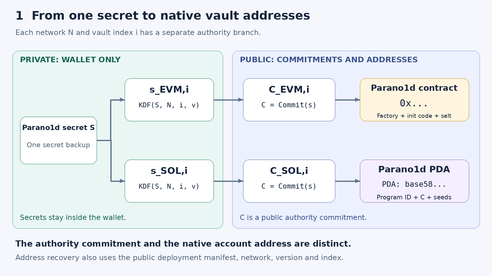

# Parano1dX

Native-asset vaults on EVM networks and Solana, authorized by proofs derived from one Parano1d secret. Assets remain on their native chain. Each vault binds withdrawals to its authority commitment, request, persistent nonce and verifier parameters.

[Research article](https://lab.parano1d.org/research/native-asset-vaults/) · [Protocol](experiments/native-vault/PROTOCOL.txt) · [Measurements](experiments/native-vault/RESULTS.txt) · [Reproduction](experiments/native-vault/README.txt)

## Public withdrawals

Complete authorization jobs observed on 8 November 2026:

| Network and delivery | Confirmation observed | Authorization transactions | Actual network fee |
| --- | ---: | ---: | ---: |
| Solana Devnet v1 | 18.08 s | 88 | 0.000445 test SOL |
| Solana Devnet v1, packet loss and reordering | 22.34 s | 91 | 0.000460 test SOL |
| Base Sepolia | 14.46 s to L2 receipts | 10 | 0.000623630745261972 test ETH |

Each job checked all 64 proof queries and consumed its withdrawal nonce once. Solana returned the complete temporary-account reserve. Signed transactions, public proofs and automated receipt cross-checks accompany each run. Timing scopes and finality observations are recorded separately in the [public-network summary](experiments/native-vault/results/public-network-summary.json).

- [Solana withdrawal](https://explorer.solana.com/tx/3xuJsArGD9oPD815KqNeMyedT57ZVUYQBbkdNzqoDMBsYy9w4vLkotsdKA93RxLYEeczuPqqHpKbhViiJcoTQdb9?cluster=devnet)
- [Solana withdrawal with interrupted delivery](https://explorer.solana.com/tx/5cFg8MmcB5gCoHyfappoBjoPrwdskauV6J6BhgyW7ntsibmHwe72zyL4UYqoRVDTyNSQdmveTuZj1JzXvFMzuMcV?cluster=devnet)
- [Base withdrawal](https://sepolia.basescan.org/tx/0x5c07ba6b176572e7033be530945a7c802c01ed7f297ff651e5ff3b3b6ef83d52)

The Base Mainnet estimate is **$1.40** for the complete ten-transaction job at the recorded fee and asset-price snapshot. It combines measured local execution gas with the Mainnet fee oracle. The [quote](experiments/native-vault/results/base/fee-quote.json) fixes block, gas price, L1 data charges and operator charges. Testnet coins and fees have their own units.

## Authorization

The wallet derives a separate authority branch for each network and vault index. A fresh randomized proof binds that authority to the withdrawal request. Relayers deliver the public proof and pay transaction fees. The native contract or Solana program verifies the proof before transferring funds.

The implementation uses a prime-field Poseidon2 authority relation and a hiding FRI proof with 64 queries, blowup eight, extension degree eight and SHA-256 || Keccak-256 commitments. Its [protocol specification](experiments/native-vault/PROTOCOL.txt) states the acceptance invariant and security conditions.

The quantitative quantum chosen-request reduction, repeated-use privacy bound and cryptanalytic assessment remain research obligations for this exact external-vault profile. The published binary-field authorization result supplies the underlying authorization interface. Applying its security analysis to this prime-field instantiation requires a separate argument.

## Source and evidence

| Path | Contents |
| --- | --- |
| `experiments/native-vault/auth/` | Authority relation, derivation, transcript and streaming verifier |
| `experiments/native-vault/prover/` | Randomized proof generation and strict reference checks |
| `experiments/native-vault/evm/` | Solidity verifier, vault, factory and local/public test clients |
| `experiments/native-vault/solana/` | SBF verifier and persistent native-SOL vault |
| `experiments/native-vault/tpu-relay/` | Direct Agave QUIC delivery |
| `experiments/native-vault/results/` | Selected public v1 runs, Base run, local fixtures and fee quotes |
| `assets/` | Architecture diagrams and measured latency figure |
| `tools/` | Figure rendering |
| `papers/` | Research article PDF |

Start with the [reproduction commands](experiments/native-vault/README.txt). Local fixtures use explicitly public research roots and deterministic transaction signers. Public-network experiments use separate private research credentials stored outside this repository. Build outputs and dependencies belong in `.build/` or `target/`.

First-party code follows the [Apache-2.0 license](LICENSE), except Solidity files with their own MIT identifiers. Vendored components retain their original licenses. [NOTICE](NOTICE) records the pinned backend and local adaptations.
